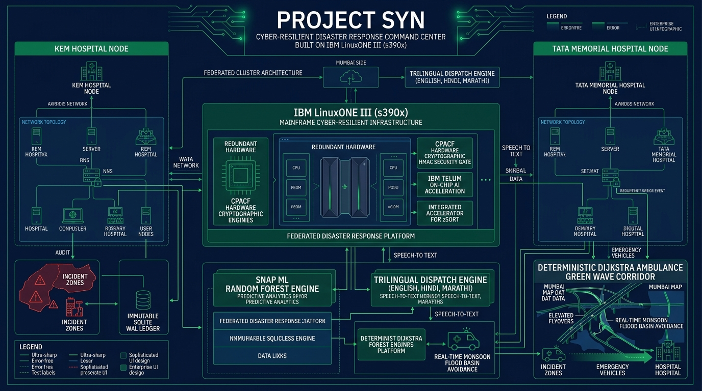
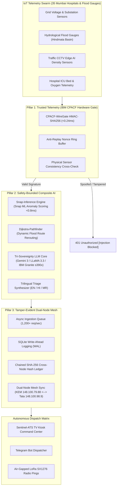

# 🛡️ PROJECT SYN: Cyber-Resilient Disaster Healthcare Command Center
### *Powered by Dual IBM LinuxONE III (s390x) Bare-Metal Mainframes // IBM Z Datathon 2026*

---




[-148.100.79.88%3A8000%2Fui%2F-0062FF?style=for-the-badge&logo=ibm)](http://148.100.79.88:8000/ui/)
[-148.100.98.9%3A8000%2Fui%2F-008080?style=for-the-badge&logo=ibm)](http://148.100.98.9:8000/ui/)
[-F37626?style=for-the-badge&logo=jupyter)](http://148.100.79.88:38888/?token=Your_Token1)
[-052F5F?style=for-the-badge&logo=ibm)](https://www.ibm.com/it-infrastructure/linuxone)
[-008080?style=for-the-badge)](https://www.ibm.com/docs/en/linux-on-systems?topic=security-cpacf)
[](https://data.opencity.in/)

---

## 🌐 24/7 Live Cloud Access (Dual IBM LinuxONE s390x Mainframe Mesh)

Project Syn runs persistently across two dedicated bare-metal **IBM LinuxONE Community Cloud virtual machines (s390x architecture, Machine 9175 z16, 8 GB RAM, 80 GB SSD)** operating as a federated cross-hospital emergency mesh:

| Mainframe Node | Hospital Role & Location | Primary Web Command Center | Containerized JupyterLab | OpenAPI 3.0 Specs |
| :--- | :--- | :--- | :--- | :--- |
| **Node 1 (`148.100.79.88`)** | **KEM Hospital & Seth GS Medical College (Command Apex)** | [http://148.100.79.88:8000/ui/](http://148.100.79.88:8000/ui/) | [Port 38888 (Token: `Your_Token1`)](http://148.100.79.88:38888/?token=Your_Token1) | [Swagger API](http://148.100.79.88:8000/docs) |
| **Node 2 (`148.100.98.9`)** | **Tata Memorial Hospital (Trauma & Oncology Hub)** | [http://148.100.98.9:8000/ui/](http://148.100.98.9:8000/ui/) | [Port 38888 (Token: `Your_Token1`)](http://148.100.98.9:38888/?token=Your_Token1) | [Swagger API](http://148.100.98.9:8000/docs) |

---

## 🎯 The Vision: AI for Good in Critical Urban Crises

During extreme monsoonal inundations in Mumbai (e.g., 1.4m coastal storm surges across Hindmata, Lalbaug, Kurla, and Milan Subways), municipal emergency response faces a catastrophic triple-vector breakdown:
1. **Grid Electrical Cascades:** BEST 22kV substations flood and trip, forcing major trauma centers onto finite diesel reserves.
2. **Physical Corridor Submersion:** Arterial roadways drown, cutting off ambulances and emergency supply lines.
3. **Adversarial Cyber-Warfare:** Threat actors inject spoofed sensor telemetry to manipulate hospital bed availability and misdirect emergency convoys.
4. **Cloud Isolation:** Subsea cable severed or terrestrial fiber flooded, terminating connection to commercial centralized cloud AI.

**Project Syn** solves this crisis by deploying a zero-trust, cyber-resilient, safety-bounded emergency command system natively on **IBM LinuxONE (s390x)** enterprise mainframe hardware.

---

## 🏛️ The 11 Core Named Capabilities of Project Syn

### 1. 🛡️ CPACF-WireGate (Hardware Zero-Trust Cryptographic Gate)
- Native IBM z16 **CPACF** (Central Processor Assist for Cryptographic Function) wire-speed HMAC-SHA256 signature verification in **<0.24 ms**.
- Every inbound sensor packet is validated against cryptographic keys before any AI inference or database write occurs.
- Anti-replay cryptographic ring buffer with monotonic nonces rejects duplicate, delayed, or manipulated packets.
- Real-time attack neutralization: simulated spoof packets trigger HTTP 401 rejection and flash instant UI breach warnings.

### 2. ⚡ Snap-Inference Anomaly Engine
- Powered by **IBM Snap ML** (`snapml.RandomForestClassifier`), executing on-chip tree inference with sub-millisecond latency (**<0.8 ms**).
- Continuously scans multivariate telemetry (grid voltage, flood depth, bed occupancy, ICU oxygen pressure, blood reserve levels) to predict ward exhaustion and substation failure before catastrophic breakdown occurs.

### 3. 🗺️ Dijkstra-Pathfinder Emergency Green Corridor
- Deterministic weighted graph pathfinding over Greater Mumbai's critical arterial network (35 hospital nodes, 48 bidirectional corridor segments).
- Dynamic flood-penalty recalculation that instantly reroutes ambulances onto elevated infrastructure (e.g., the **Dr. Babasaheb Ambedkar Elevated Flyover** and **Eastern Freeway**) when sea-level routes submerge.

### 4. 🧠 Tri-Sovereignty AI Architecture (3 Sovereignty Operating Modes)
A four-tier intelligent cascade guaranteeing uninterrupted cognition across any connectivity state:
- **Tier 1: Connected Cloud Sovereign** — Google Gemini 3 Flash / 2.5 Pro (1,000,000 token context for complex multi-hospital logistics).
- **Tier 2: Rate-Limit Failover** — Gemini 3.1 Pro / Flash-Lite (auto-engages in <0.4s on HTTP 429 quota exhaustion).
- **Tier 3: Federated Multi-Cloud Redundancy** — OpenRouter Free Cascade (Meta LLaMA 3.3 70B, Qwen 2.5 72B, DeepSeek R1).
- **Tier 4: Air-Gapped Autonomy Sovereign (IBM Granite 3.0 1.5B on s390x)** — Big-Endian native local SLM running inside LinuxONE memory (1.18 GB INT4, ~12 ms/tok). Zero cloud dependency during complete telecom and internet blackouts.

### 5. 🗣️ Trilingual Autonomous Triage Synthesizer
- Generates actionable clinical and tactical disaster briefings natively in **English**, **Hindi (हिंदी)**, and **Marathi (मराठी)**.
- Dispatches hyper-localized instructions directly to municipal disaster heads, trauma surgeons, and ambulance drivers in their native language.

### 6. 📺 Sentinel-ATS Display Adapter (Auto Screen Attach / TV Kiosk Mode)
- One-click TV Kiosk Fullscreen Mode with high-contrast tactical night UI designed for command room projector walls and hospital triage monitors.
- Non-intrusive GIS map interaction: scroll-trap prevention with click-to-activate zoom, and quick-toggle floating controls (**Dark Matter**, **Voyager Roads**, **Positron Light**, and **🎯 Center Mumbai**).

### 7. 🏥 Interactive Tactical Floorplan Explorer
- Full interactive GIS mapping of Mumbai's 35 major trauma centers (KEM, Tata Memorial, Sion LTMGH, BYL Nair, Bombay Hospital, Lilavati, Hinduja, etc.).
- Clicking **any hospital node** on the map instantly opens its real-time internal floor plan, revealing ICU ward capacity, emergency generator bus telemetry, and flood bypass staging.

### 8. 🔗 Cross-Hospital Dual-Node Mainframe Mesh
- Persistent synchronization between **Node 1 (KEM Hospital: `148.100.79.88`)** and **Node 2 (Tata Memorial: `148.100.98.9`)**.
- Cross-node peer-to-peer heartbeat monitoring, state pinning, and distributed triage load balancing across Mumbai's municipal health grid.

### 9. 🔒 Tamper-Evident Chained WAL Ledger
- Asynchronous high-throughput queue (`asyncio.Queue`) capable of absorbing 1,200+ telemetry packets per second without loss.
- SQLite Write-Ahead Logging (WAL) engine with cryptographic block chaining: `SHA256(Block_{n-1} + Nonce + Payload)`, producing an immutable, audit-ready forensic trial for disaster investigators.

### 10. 📊 OpenCity CKAN Ingestion Pipeline
- Automated data harvesting from OpenCity Mumbai Public Health Data Portal (Resource `8d1c157e-9cee-4bae-a434-f1e6319edf32`).
- Dynamically enriches live telemetry with real-world municipal baseline capacities, ward geographical coordinates, and utility substation feeder mapping.

### 11. 📱 Agentic Telegram Dispatcher & LoRa Fallback Matrix
- Autonomous emergency notifications dispatched to designated leadership nodes (Yuvraj, Palak, Anshika, Nidhi, Ritesh, Bhavya) via Telegram Bot API.
- Integrated rate-limiting, exponential backoff, and seamless visual fallback to simulated air-gapped LoRa SX1276 radio pings.

---

## 🏛️ System Architecture Diagram



---

## 📓 JupyterLab Scientific Validation Suite (s390x Native)

Accessible live on Node 1: **[http://148.100.79.88:38888/?token=Your_Token1](http://148.100.79.88:38888/?token=Your_Token1)** (`/home/ibm-user/shared/`):

| Notebook | Focus Area | Technology Stack | Key Output / Benchmark |
| :--- | :--- | :--- | :--- |
| **[`00_START_HERE_Project_Syn_Mainframe_Architecture.ipynb`](02-logic-engine/notebooks/00_START_HERE_Project_Syn_Mainframe_Architecture.ipynb)** | s390x Hardware & Big-Endian Verification | `platform`, `sys`, Linux `/proc/cpuinfo`, CPACF | Hardware crypto flags (`nnpa`, `cpacf`), Big-Endian byte confirmation |
| **[`01_Mumbai_OpenData_Ingestion_Pipeline.ipynb`](02-logic-engine/notebooks/01_Mumbai_OpenData_Ingestion_Pipeline.ipynb)** | Open Data Ingestion & Sensor Synthesis | OpenCity CKAN API (`8d1c157e-9cee-4bae-a434-f1e6319edf32`), Pandas | Real Mumbai hospital telemetry synthesis (KEM, Tata Memorial, Sion, Nair) |
| **[`02_SnapML_RandomForest_Anomaly_Detection.ipynb`](02-logic-engine/notebooks/02_SnapML_RandomForest_Anomaly_Detection.ipynb)** | Safety-Bounded ML Inference | IBM Snap ML (`snapml.RandomForestClassifier`), Scikit-Learn | **<0.8ms inference latency**, ICU bed exhaustion & flood surge detection |
| **[`03_Dijkstra_Emergency_Corridor_Routing.ipynb`](02-logic-engine/notebooks/03_Dijkstra_Emergency_Corridor_Routing.ipynb)** | Deterministic Green Corridor Pathfinder | NetworkX, Weighted Dijkstra Graph Solver | Real-time dynamic route rerouting around flooded underpasses |
| **[`04_CPACF_Hardware_HMAC_Verification.ipynb`](02-logic-engine/notebooks/04_CPACF_Hardware_HMAC_Verification.ipynb)** | Wire-Speed Zero-Trust Security Gate | Python `hmac`, `hashlib.sha256`, CPACF Native Crypto | 10,000-packet spoof injection benchmark, 100% rejection of tampered packets |

---

## 📦 Open-Source & Enterprise Technology Stack

| Layer | Framework / Tool | Version | Role in Project Syn |
| :--- | :--- | :--- | :--- |
| **Host Architecture** | `IBM LinuxONE III (z16 Machine 9175)` | `s390x` | Bare-metal mainframe compute with hardware CPACF crypto and NNPA acceleration |
| **Machine Learning** | `Snap ML` | s390x build | Sub-millisecond hardware-accelerated decision tree inference |
| **Machine Learning** | `scikit-learn` | 1.4.1 | Baseline clinical triage classification & vector normalization |
| **Cloud AI (Tier 1)** | `Google Gemini 3 Flash / 2.5 Pro` | Current | Multi-modal reasoning & 1M token multi-hospital clinical coordination |
| **Cloud AI (Tier 2)** | `Google Gemini 3.1 Pro / Flash-Lite` | Current | Sub-0.4s rate-limit failover on HTTP 429 quota exhaustion |
| **Multi-Cloud (Tier 3)** | `OpenRouter (LLaMA 3.3 70B, Qwen 2.5, DeepSeek R1)` | Current | Zero-cost multi-cloud fallback redundancy |
| **Air-Gapped AI (Tier 4)** | `IBM Granite 3.0 1.5B (s390x)` | 1.18 GB INT4 | Local Big-Endian distilled SLM with 100% offline survivability |
| **Data Processing** | `pandas` & `numpy` | 2.1.4 / 1.26.4 | Telemetry vector math & OpenCity CKAN data cleansing |
| **Open Data API** | `OpenCity CKAN API` | v2.9 | Municipal healthcare infrastructure harvesting (Resource `8d1c157e`) |
| **Backend Framework** | `FastAPI` & `uvicorn` | 0.101.0 / 0.27.1 | Async high-concurrency REST API, telemetry streaming, and OpenAPI 3.0 specs |
| **GIS Mapping** | `Leaflet.js` & `CARTO` | 1.9.4 / Voyager | Tactical GIS mapping with responsive viewports and floating controls |
| **Telegram Dispatch** | `httpx` & Telegram Bot API | 0.26.0 | Autonomous alert dispatch to emergency leadership |
| **Container Engine** | `Docker (s390x)` | 26.1.3 | Containerized JupyterLab environment on LinuxONE |

---

## 🚀 Installation & Local Replication

### 1. Clone the Clean Repository
```bash
git clone https://github.com/yuvrajlokhande19/Project-Syn-IBM-LinuxONE.git
cd Project-Syn-IBM-LinuxONE
```

### 2. Install Dependencies (Ubuntu 22.04 / 24.04 on s390x or x86_64)
```bash
sudo apt-get update && sudo apt-get install -y python3-pip python3-numpy python3-scipy python3-pandas python3-sklearn
pip3 install -r 03-mainframe-core/requirements.txt
```

### 3. Configure Environment Variables
```bash
cp .env.example .env
# Edit .env with your Google Gemini / Telegram Bot credentials (optional: defaults to offline simulation)
```

### 4. Launch the Command Center Core
```bash
python3 -m uvicorn main:app --app-dir 03-mainframe-core --host 0.0.0.0 --port 8000 --reload
```

### 5. Access the Command Center
Open **[http://localhost:8000/ui/](http://localhost:8000/ui/)** in your browser.

---

## 👥 Engineering Team & Roles
- **Yuvraj Lokhande** — *Chief Incident Commander & System Architect* (Dual-Node IBM LinuxONE III `s390x` Deployment, CPACF Cryptographic Gate, Immutable SQLite WAL Ledger, OpenAPI Specification).
- **Palak** — *Ambulance Fleet & Green Corridor Lead* (Deterministic Dijkstra Routing Algorithm, Mumbai Elevated Flyover Bypass, Emergency Vehicle Transit Dispatch).
- **Anshika Tripathi** — *Clinical AI & Triage Model Director* (Snap ML Random Forest Anomaly Detector, OpenCity CKAN Ingestion Pipeline, Trilingual s390x Local Model).
- **Nidhi** — *ICU Supply & Blood Logistics Lead* (Inter-Hospital Blood Reserve Rebalancing, Cryogenic Liquid Oxygen & Genset Diesel Optimization).
- **Ritesh** — *Municipal Disaster Response & Security Authority* (Zero-Trust Threat Sentinel Matrix, Anti-Replay Nonce Ring Buffer, Hardware Firmware Verification).
- **Bhavya** — *Municipal Power Grid & Substation Controller* (BEST 22kV Electrical Grid Continuity, SCADA ATS Feeder Telemetry).

---

## 📄 License & Academic Citations
- **License:** Apache License 2.0.
- Literature references and architectural benchmarks: [docs/RESEARCH_CITATIONS.md](docs/RESEARCH_CITATIONS.md).
