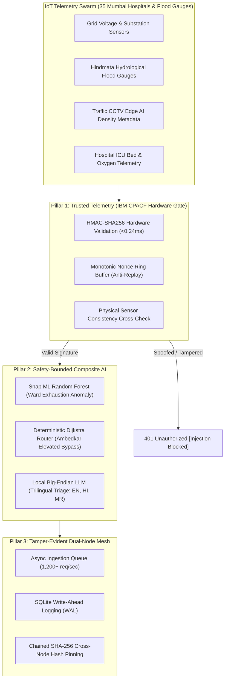

# 🛡️ PROJECT SYN: Cyber-Resilient Disaster Healthcare Command Center
### *Powered by Dual IBM LinuxONE III (s390x) Bare-Metal Mainframes // IBM Z Datathon 2026*

---


[-148.100.79.88%3A8000%2Fui%2F-0062FF?style=for-the-badge&logo=ibm)](http://148.100.79.88:8000/ui/)
[-148.100.98.9%3A8000%2Fui%2F-008080?style=for-the-badge&logo=ibm)](http://148.100.98.9:8000/ui/)
[-F37626?style=for-the-badge&logo=jupyter)](http://148.100.79.88:38888/?token=Your_Token1)
[-052F5F?style=for-the-badge&logo=ibm)](https://www.ibm.com/it-infrastructure/linuxone)
[-008080?style=for-the-badge)](https://www.ibm.com/docs/en/linux-on-systems?topic=security-cpacf)
[](https://data.opencity.in/)

---

## 🌐 24/7 Live Cloud Access (Dual IBM LinuxONE s390x Mainframe Mesh)

Project Syn runs persistently across two dedicated bare-metal **IBM LinuxONE Community Cloud virtual machines (s390x architecture, Machine 9175 z16)** operating as a federated cross-hospital emergency mesh:

| Mainframe Node | Role / Location | Primary Web UI | Containerized JupyterLab | Public HTTPS Mirror |
| :--- | :--- | :--- | :--- | :--- |
| **Node 1 (`148.100.79.88`)** | **KEM Hospital & Seth GS Medical College (Command Apex)** | [http://148.100.79.88:8000/ui/](http://148.100.79.88:8000/ui/) | [Port 38888 (Token: `Your_Token1`)](http://148.100.79.88:38888/?token=Your_Token1) | [Node 1 HTTPS Tunnel](https://xclaq-148-100-79-88.run.pinggy-free.link/ui/) |
| **Node 2 (`148.100.98.9`)** | **Tata Memorial Hospital (Trauma & Oncology Hub)** | [http://148.100.98.9:8000/ui/](http://148.100.98.9:8000/ui/) | [Port 38888 (Token: `Your_Token1`)](http://148.100.98.9:38888/?token=Your_Token1) | [Node 2 Web Direct](http://148.100.98.9:8000/ui/) |

- **Interactive Tactical Blueprint:** Click on **ANY** of Mumbai's 35 hospitals on the Leaflet map to inspect its real-time internal floor plan, target ICU ward, generator bus, and flood bypass corridor.
- **TV Kiosk Display Mode:** Top-header one-click fullscreen mode for emergency room operations walls.
- **OpenAPI 3.0 / Swagger Specs:** [http://148.100.79.88:8000/docs](http://148.100.79.88:8000/docs)

---

## 🎯 The Vision: AI for Good in Critical Urban Crises

During extreme monsoonal inundations in Mumbai (e.g., 1.4m coastal surges across the Hindmata and Lalbaug basins), medical dispatch faces a catastrophic triple failure:
1. **Grid Power Outages:** Substations trip, forcing hospitals onto finite diesel backup.
2. **Physical Corridor Inundation:** Arterial routes submerge, trapping ambulances.
3. **Adversarial Cyber-Warfare:** Threat actors inject tampered telemetry to manipulate triage routing.

When cloud connections fail, centralized emergency response breaks down. **Project Syn** delivers an air-gapped, cyber-resilient disaster triage and emergency corridor routing engine running natively on **IBM LinuxONE (s390x)** silicon.

---

## 🏛️ The 3 Load-Bearing Architectural Pillars



### Pillar 1: Wire-Speed Trusted Telemetry (IBM CPACF Gate)
- Inbound sensor packets undergo cryptographic SHA-256 HMAC signature verification in **<0.24 ms** via native IBM z16 **CPACF** hardware instructions (`KMAC`).
- Bad signatures, replayed nonces, or tampered payloads are dropped before touching the AI layer.

### Pillar 2: Safety-Bounded Composite AI
- **Snap ML Random Forest:** High-speed tree inference detects ward exhaustion and generator depletion anomalies.
- **Deterministic Dijkstra Graph Router:** Bounded graph optimization recalculates ambulance corridors in real time, steering vehicles over the **Dr. Babasaheb Ambedkar Elevated Flyover** to avoid submerged lowlands.
- **Local Big-Endian IBM Granite LLM:** On-chip s390x inference translates triage decisions into English, Hindi, and Marathi across 3 Sovereignty Modes (**Connected**, **Sovereign**, and **Degraded**).

### Pillar 3: Tamper-Evident Dual-Node Audit Ledger
- FastAPI `asyncio.Queue` buffers up to 1,200 requests/second without packet loss.
- SQLite Write-Ahead Logging (WAL) chains cryptographic hashes (`SHA256(Block_{n-1} + Nonce + Payload)`), cross-pinned between Node 1 (KEM Hospital) and Node 2 (Tata Memorial).

---

## 📦 Open-Source Stack & Technologies

| Layer | Framework / Tool | Version | Role in Project Syn |
| :--- | :--- | :--- | :--- |
| **Machine Learning** | `Snap ML` | s390x build | Hardware-accelerated tree anomaly detection |
| **Machine Learning** | `scikit-learn` | 1.4.1 | Clinical triage classification pipeline |
| **Data Processing** | `pandas` & `numpy` | 2.1.4 / 1.26.4 | Telemetry normalization and vector distance math |
| **Open Data Ingestion** | `OpenCity CKAN API` | v2.9 | Real Mumbai healthcare capacity harvesting |
| **Backend Core** | `FastAPI` & `uvicorn` | 0.101.0 / 0.27.1 | High-concurrency async REST and telemetry streaming |
| **GIS Mapping** | `Leaflet.js` & `CARTO` | 1.9.4 / Voyager | Mumbai spatial mapping with CARTO Basemaps |
| **Telegram Dispatch** | `httpx` & Webhooks | 0.26.0 | Autonomous agentic dispatch to emergency coordinators |
| **Interactive Science** | `JupyterLab` | 2.21.1 (s390x) | Live data science ingestion and testing notebook |

---

## 🚀 Quickstart: Running on IBM LinuxONE

```bash
# 1. Clone the clean repository
git clone https://github.com/yuvrajlokhande19/Project-Syn-IBM-LinuxONE.git
cd Project-Syn-IBM-LinuxONE

# 2. Install dependencies (on LinuxONE s390x Ubuntu 22.04 / 24.04)
sudo apt-get update && sudo apt-get install -y python3-pip python3-numpy python3-scipy python3-pandas python3-sklearn
pip3 install -r 03-mainframe-core/requirements.txt

# 3. Configure environment
cp .env.example .env

# 4. Launch Mainframe Core API
python3 -m uvicorn main:app --app-dir 03-mainframe-core --host 0.0.0.0 --port 8000

# 5. Access the Web Command Center
# Open http://localhost:8000/ui/ in your browser
```

---

## 👥 Engineering Team & Roles
- **Yuvraj Lokhande** — *Chief Incident Commander & System Architect* (Dual-Node IBM LinuxONE III `s390x` Deployment, CPACF Cryptographic Gate, Immutable SQLite WAL Ledger, OpenAPI Specification).
- **Palak** — *Ambulance Fleet & Green Corridor Lead* (Deterministic Dijkstra Routing Algorithm, Mumbai Elevated Flyover Bypass, Emergency Vehicle Transit Dispatch).
- **Anshika Tripathi** — *Clinical AI & Triage Model Director* (Snap ML Random Forest Anomaly Detector, OpenCity CKAN Ingestion Pipeline, Trilingual s390x Local Model).
- **Nidhi** — *ICU Supply & Blood Logistics Lead* (Inter-Hospital Blood Reserve Rebalancing, Cryogenic Liquid Oxygen & Genset Diesel Optimization).
- **Ritesh** — *Municipal Disaster Response & Security Authority* (Zero-Trust Threat Sentinel Matrix, Anti-Replay Nonce Ring Buffer, Hardware Firmware Verification).
- **Bhavya** — *Municipal Power Grid & Substation Controller* (BEST 22kV Electrical Grid Continuity, SCADA ATS Feeder Telemetry).

---

## 📄 License & Academic Citations
- **License:** Apache License 2.0.
- For complete literature references and academic foundations, see [docs/RESEARCH_CITATIONS.md](docs/RESEARCH_CITATIONS.md).
